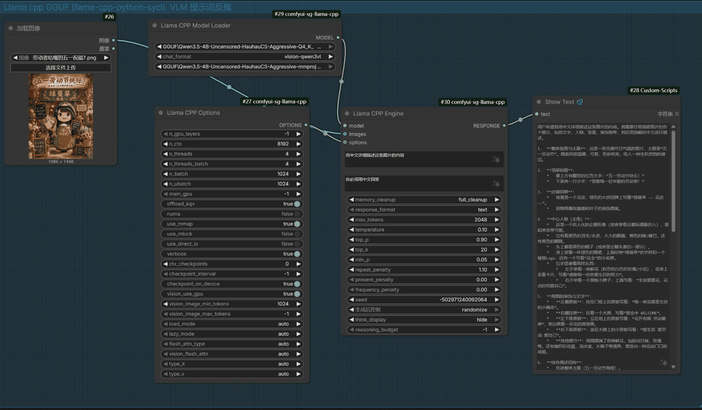
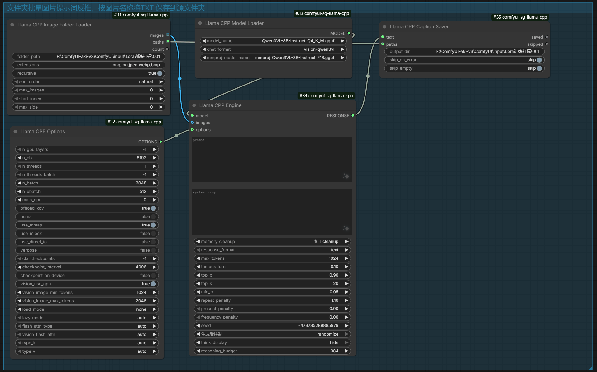

[中文](README.md) | English

# comfyui-sg-llama-cpp

Run GGUF language and vision models inside ComfyUI. Tuned for **Intel Arc / Iris Xe (SYCL)**,
extended with a **batch captioning pipeline** for LoRA datasets.

The pack does two jobs:

| Job | Wiring | Use case |
|---|---|---|
| Single-image inference | Model Loader → Options → Engine | describe an image, rewrite a prompt, ask a question about a picture |
| Batch captioning | Image Folder Loader → Engine → Caption Saver | one `.txt` per image, for a LoRA dataset |

Both share the same engine and the same GGUF. No third-party nodes are required for either (the
`Show Text` in the screenshots only displays the result — ComfyUI's own preview nodes work too).

---

## Contents

- [Requirements](#requirements)
- [Installation](#installation)
- [Quick start](#quick-start)
- [Node reference](#node-reference)
- [Model discovery](#model-discovery)
- [Batch captioning in practice](#batch-captioning-in-practice)
- [Measured on Intel Arc B580](#measured-on-intel-arc-b580)
- [Troubleshooting](#troubleshooting)
- [What this fork changes](#what-this-fork-changes)
- [License and links](#license-and-links)

---

## Requirements

| Component | Requirement | Notes |
|---|---|---|
| ComfyUI | a build shipping `comfy_api.latest` | these nodes use the V3 schema API (`define_schema`), not the legacy `INPUT_TYPES` |
| llama-cpp-python | **>= 0.3.39** | 0.3.39+ is required (MTMD rewrite); 0.4.x additionally unlocks `load_mode`, KV quantization and `reasoning_budget` |
| GPU backend | SYCL wheel for Intel Arc | JamePeng's releases have **no** SYCL builds — see below |

The plugin detects what the installed `llama-cpp-python` supports **from its function
signatures, not from the version string**, and drops parameters the build does not know about.
One install of this plugin serves 0.3.x and 0.4.x alike; unsupported widgets simply do nothing.

## Installation

### 1. Install a wheel

**Intel GPU (SYCL)** — prebuilt Windows wheels:

```
https://github.com/allanmeng/llama-cpp-python-sycl-windows
```

**Other backends (CUDA / CPU / Vulkan):**

```
https://github.com/JamePeng/llama-cpp-python/releases
```

### 2. Clone the node pack

```bash
cd ComfyUI/custom_nodes
git clone https://github.com/allanmeng/comfyui-sg-llama-cpp
```

### 3. Restart ComfyUI

Both nodes appear under the `LlamaCPP` category (`LlamaCPP/Dataset` for the captioning pair).

### Upgrading from llama-cpp-python 0.3.38 or earlier

Do **not** use `pip install --upgrade`. Stale DLLs left in `lib/` collide with the new build:

```bat
pip uninstall llama-cpp-python -y
pip install llama_cpp_python-<version>-<your-build>.whl
```

> On Windows, the 0.3.39+ MTMD rewrite moved vision handling into `GenericMTMDChatHandler`
> and replaced `clip_model_path` with `mmproj_path`. Installing a 0.3.39+ wheel over a 0.3.38
> install without uninstalling first is the most common cause of "the node loads but vision
> output is garbage".

### 4. Optional configuration

Drop a `config.json` next to `__init__.py` to add model folders or hide noise — see
[Model discovery](#model-discovery). The plugin works without it.

---

## Quick start

Both screenshots below are complete working graphs — copy the wiring as-is. They use different
models, which is rather the point: swapping models means changing only the two dropdowns in the
Model Loader.

### Describing a single image



Five nodes. `Load Image` supplies `IMAGE`, the Model Loader supplies `MODEL`, Options supplies
`OPTIONS`, and all three converge on the Engine; the Engine's `RESPONSE` then feeds a display
node. Drop any one of the three lines and nothing runs — in particular, with
`mmproj_model_name` empty, `images` is silently ignored: the output looks fine while the model is
answering without ever having seen the picture.

The Engine's two text boxes do different jobs. `prompt` is the instruction for this run,
`system_prompt` is the persona. The screenshot uses a Chinese instruction ("describe this image in
detail in Chinese") plus a Chinese system prompt ("you must answer in Chinese") — the latter
matters for 4B–8B models, which otherwise drift back to English mid-answer.

`Show Text` on the right comes from
[ComfyUI-Custom-Scripts](https://github.com/pythongosssss/ComfyUI-Custom-Scripts)
(`ShowText|pysssss`). Its only job here is rendering long text as readable lines; any node that
accepts `STRING` is equivalent. The checked-in `demo_workflow_llama-cpp-python_0.3.39+.json` is
this graph.

**The four settings that actually matter**

| Setting | Where | Why |
|---|---|---|
| `mmproj_model_name` | Model Loader | without it the model runs text-only and `images` is ignored |
| `n_ctx = 8192` | Options | one large image is 4000+ vision tokens; the old `2048` default cannot hold it |
| `max_tokens = 2048` | Engine | a detailed description is easily 500+ tokens, and reasoning models spend budget before the answer |
| `think_display = hide` | Engine | strips the `<think>` block so `RESPONSE` is the answer, not the monologue |

Leave `chat_format` at its default. For vision models the handler is chosen automatically
from the `mmproj` file; the combo only matters for text-only models with an unusual template.

### Batch captioning a folder



It differs from the graph above at both ends only: `Image Folder Loader` replaces `Load Image`, and
`Caption Saver` replaces `Show Text`. The loader hands over the whole folder at once (`images` is a
**list**, not a tensor batch), so ComfyUI expands the Engine N times — once per image — and the
saver writes one `.txt` per execution.

The third wire, `paths`, does exactly one job: pass each source path to the saver so the caption
lands beside its image under a matching name (`abc.png` → `abc.txt`). Leave it unconnected and the
run still works, but filenames degrade to `caption_00001.txt`.

In the screenshot `max_images = 0` means no limit. Set it to `3` for one validation pass first.
Details and recommended settings:
[Batch captioning in practice](#batch-captioning-in-practice).

---

## Node reference

### Llama CPP Model Loader

`LlamaCPP` · outputs `MODEL`

| Input | Req | Default | Notes |
|---|:--:|---|---|
| `model_name` | yes | — | every `.gguf` found by the [model scan](#model-discovery) except files with `mmproj` in the name |
| `chat_format` | no | `llama-2` | only used for text-only models; vision models pick their handler from the mmproj |
| `mmproj_model_name` | no | `None` | files with `mmproj` in the name. `None` = text-only |

### Llama CPP Options

`LlamaCPP` · outputs `OPTIONS`

**Core**

| Input | Default | Notes |
|---|---|---|
| `n_gpu_layers` | `-1` | `-1` = offload everything |
| `n_ctx` | `8192` | raise it for large images or long prompts. `8192` is the tested floor |
| `n_threads` / `n_threads_batch` | `-1` | `-1` = auto |
| `n_batch` / `n_ubatch` | `2048` / `512` | larger `n_batch` speeds up prefill at the cost of memory |
| `main_gpu` | `0` | device index |
| `offload_kqv` | on | keep K/Q/V on the GPU |
| `numa` | off | NUMA affinity (multi-socket hosts) |
| `verbose` | off | floods the console with per-tensor and per-token lines. When on, the resolved tuning parameters are echoed back |

**Vision**

| Input | Default | Notes |
|---|---|---|
| `vision_use_gpu` | on | run the vision encoder on the GPU |
| `vision_image_min_tokens` | `1024` | Qwen-VL's minimum. `-1` = handler default |
| `vision_image_max_tokens` | `-1` | `-1` = handler default. Must be `-1` or `>= min_tokens`; an inconsistent value is dropped with a warning instead of aborting the run |

**Hybrid / recurrent models (Qwen3.5 and friends)**

| Input | Default | Notes |
|---|---|---|
| `ctx_checkpoints` | `-1` | `-1` = llama-cpp-python default (16). **Do not use `0`** — it hits a buggy fast-path that crashes on large images |
| `checkpoint_interval` | `4096` | checkpoint token interval |
| `checkpoint_on_device` | off | keeps checkpoint payloads in VRAM (~50 MiB each). Benchmarked: no throughput change, so off is fine |

**Load strategy** (`llama-cpp-python` 0.4.x only; ignored by 0.3.x)

| Input | Default | Notes |
|---|---|---|
| `use_mmap` / `use_mlock` / `use_direct_io` | on / off / off | **[DEPRECATED in 0.4.x]** removed from the 0.4.x load path. Still honored by 0.3.x. On 0.4.x use `load_mode` |
| `load_mode` | `auto` | `auto` / `none` / `mmap` / `mlock` / `mmap_mlock` / `direct_io` |
| `lazy_mode` | `auto` | `auto` / `off` / `on`. Requires mmap |
| `flash_attn_type` | `auto` | Flash Attention for the main model: `auto` / `disabled` / `enabled` |
| `vision_flash_attn` | `auto` | Flash Attention inside the vision encoder: `auto` / `enabled` / `disabled` |
| `type_k` / `type_v` | `auto` | KV cache data type: `auto` / `f16` / `bf16` / `q8_0` / `q5_1` / `q5_0` / `q4_1` / `q4_0` / `iq4_nl`. `auto` = f16. **A quantized `type_v` requires Flash Attention** — the combination with `flash_attn_type=disabled` is rejected up front. See [the measurement](#measured-on-intel-arc-b580) before enabling it |

> The 0.4.x inputs are **appended at the end** of the parameter list on purpose. ComfyUI
> stores widget values positionally, so inserting them earlier would shift every value of
> every workflow saved before the upgrade.

### Llama CPP Engine

`LlamaCPP` · outputs `RESPONSE`

**Generation**

| Input | Default | Notes |
|---|---|---|
| `model` / `prompt` | — | required |
| `images` | — | single image or batch |
| `options` | — | from the Options node |
| `system_prompt` | empty | |
| `response_format` | `text` | `text` or `json_object`. `json_object` reveals a `json_schema` field that constrains the output to valid JSON |
| `max_tokens` | `2048` | raise it if the answer gets cut off |
| `memory_cleanup` | `full_cleanup` | `close` / `backend_free` / `full_cleanup` / `persistent`. See [memory strategy](#memory-strategy) |
| `think_display` | `hide` | `hide` returns only the text after the last `</think>`; `show` keeps the block. Handles malformed tags (missing opening, doubled closing, dangling open) |
| `reasoning_budget` | `-1` | 0.4.x only. Caps the first `<think>` block at N tokens: `-1` = library default, `0` = close it immediately, `N` = at most N reasoning tokens |

**Sampling**

| Input | Default | | Input | Default |
|---|---|---|---|---|
| `temperature` | `0.1` | | `repeat_penalty` | `1.1` |
| `top_p` | `0.9` | | `present_penalty` | `0.0` |
| `top_k` | `20` | | `frequency_penalty` | `0.0` |
| `min_p` | `0.05` | | `seed` | `1` (with control-after-generate) |

### Llama CPP Memory Cleanup

`LlamaCPP` · outputs `PASSTHROUGH` (the input, unchanged)

| Input | Default | Notes |
|---|---|---|
| `memory_cleanup` | `close` | `close` / `backend_free` / `full_cleanup` / `persistent` |
| `passthrough` | — | optional; lets you splice this node into a chain without breaking the graph |

### Llama CPP Image Folder Loader

`LlamaCPP/Dataset` · outputs `images` (list), `paths` (list), `count`

Emits a **list**, one item per file. That is the whole point: a downstream node without
`INPUT_IS_LIST` then runs once per image. A folder loader that emits a *tensor batch*
instead puts every image into a single request and runs out of context on the first try.

| Input | Default | Notes |
|---|---|---|
| `folder_path` | empty | absolute path used as-is; relative resolves under `ComfyUI/input` |
| `extensions` | `png,jpg,jpeg,webp,bmp` | comma separated |
| `recursive` | on | scan sub-folders |
| `sort_order` | `natural` | `natural` (2 before 10) / `name` / `modified` / `none` |
| `max_images` | `0` | `0` = all. Set a small number to validate the graph first |
| `start_index` | `0` | skip the first N after sorting, to resume an interrupted run |
| `max_side` | `0` | downscale so the longest side is at most N pixels (`0` = keep original). The cheapest lever on vision token count and base64 size; `1024` is a good captioning default |

Images are EXIF-rotated upright and transparent pixels are composited onto white (not black).
An undecodable file is skipped with a warning instead of aborting the batch.

### Llama CPP Caption Saver

`LlamaCPP/Dataset` · outputs `saved`, `skipped`

Writes one `.txt` per caption, **next to the source image with the same stem**
(`abc.png` → `abc.txt`) — the pairing kohya-style trainers expect. Images are never
re-encoded or renamed.

| Input | Default | Notes |
|---|---|---|
| `text` | — | `RESPONSE` from the engine |
| `paths` | — | `paths` from the loader. Unconnected = numbered files (`caption_00000.txt`, ...) inside `output_dir` |
| `output_dir` | empty | empty = beside each source image; relative resolves under `ComfyUI/input` |
| `skip_on_error` | on | drops captions that are the engine's error string (`Error generating response: ...`). Without it a failed image silently becomes a garbage caption |
| `skip_empty` | on | drops blank captions |

Files are UTF-8 with `\n` endings and no BOM, and every write is echoed so a batch can be
audited afterwards:

```
[llama_cpp dataset] caption saved: ...\ComfyUI_1057334871997372_.txt (223 chars)
[llama_cpp dataset] captions: 3 saved, 0 skipped
```

---

## Model discovery

`.gguf` files are picked up **recursively** from:

| Source | Path | Auto |
|---|---|:--:|
| ComfyUI text encoders | `ComfyUI/models/text_encoders/` and `ComfyUI/models/clip/` | yes |
| Dedicated LLM folder | `ComfyUI/models/LLM/` | yes |
| Custom folders | any path in `config.json` | no |

Files are then split into two dropdowns by name:

- **Model dropdown** — every `.gguf` whose filename does not contain `mmproj`
- **mmproj dropdown** — every `.gguf` whose filename contains `mmproj`

Location does not matter for `mmproj` files; only the keyword in the filename does.

### Recommended layout

```
ComfyUI/models/LLM/
├── Qwen3.5-4B-Q4_K_M.gguf
├── Qwen3.5-4B-mmproj-BF16.gguf
├── Qwen2.5-VL-3B-instruct-q4_k_m.gguf
└── mmproj/
    └── Qwen2.5-VL-3B-Instruct-mmproj-f16.gguf
```

### config.json

Optional. Without it the plugin only scans the ComfyUI model folders.

```json
{
  "model_folders": [
    "D:\\AI\\LLM\\models",
    "/home/user/models"
  ],
  "exclude_patterns": [
    "wan22",
    "krea2",
    "qwen_image"
  ]
}
```

- Absolute and relative paths are both accepted; non-existent paths are filtered out silently.
- `model_folders` is scanned in addition to the auto-detected folders, never instead of them.
- `exclude_patterns` is a list of **case-insensitive substrings** matched against each model's
  path relative to its search folder. Matches disappear from **both** dropdowns, models and
  mmproj alike. Use it when `model_folders` points at a directory shared with a diffusion or
  video loader — llama.cpp cannot run those GGUFs, they only lengthen the list.

See `config.example.json`.

---

## Batch captioning in practice

### Memory strategy

| `memory_cleanup` | Behaviour | Batch captioning |
|---|---|---|
| `full_cleanup` | releases the model after every generation, reloads on the next one | **default.** On a 4B-class model the reload costs ~2 s per image, which is far cheaper than the alternative |
| `persistent` | keeps the model resident between runs | measured **~26× slower** on a hybrid vision model. Prefix/KV reuse on a hybrid (recurrent) architecture carries an overhead that dwarfs the load it saves. Do not use it for tagging |
| `close` / `backend_free` | lighter versions of the teardown | fine for one-off runs, not for batches |

The loader is `not_idempotent`, so adding images to the folder is picked up without restarting
ComfyUI.

### Per-image timing

Every generation prints one line, **regardless of `verbose`**:

```
[llama_cpp] image timing | load 2.20s | generate 5.72s | total 7.93s | prompt 252 tok, out 60 tok (10.5 tok/s)
```

`verbose` exists but is not usable for measuring a batch: llama.cpp prints hundreds of
`find_slot` / per-tensor lines per image, and ComfyUI itself only reports one
`Prompt executed in X seconds` for the whole run. This line is what makes `N images × per-image
cost` visible.

### Caption hygiene

- One paragraph, one line, UTF-8, no BOM. `str.strip()` does not remove U+FEFF, so a BOM that
  reaches the response would be written to disk — check the first bytes if a tokenizer
  complains about an extra token at position 0.
- Keep the language and style of your captions identical to the prompts you will use at
  inference time. A tag list in training and a sentence at inference is one of the most
  common reasons a LoRA underperforms.
- Watch the unit-count, not the character count: what matters is that every *variable*
  attribute (clothing, background, framing) is written down, so the model does not bind it to
  the trigger word.

### Recommended first run

| Setting | Value | Why |
|---|---|---|
| `max_images` | `3` | validate the graph and read three captions before paying for the whole folder |
| `max_side` | `1024` | a 2000 px image is ~4× the vision tokens of a 1000 px one, for no gain in caption quality |
| `n_ctx` | `8192` | headroom for one large-image prefill plus the answer |
| `max_tokens` | `512`–`2048` | too small and the answer is cut mid-sentence; a truncated reasoning block is worse than a short answer, so also set `reasoning_budget` |
| `reasoning_budget` | `256`–`512` | stops thinking from eating the whole budget. Must sit **well below** `max_tokens`, otherwise the forced `</think>` is never reached |

Add `sort_order = modified` if you just generated the images and want them in creation order.

---

## Measured on Intel Arc B580

Environment: Arc B580 (12 GB, SYCL), llama-cpp-python 0.4.3, Qwen3.5-4B-Uncensored Q4_K_M,
1792×2304 image (4032 vision tokens), `n_ctx=8192`. Numbers are single-machine; treat them as
direction, not as a spec. Nothing here was measured on Arc B70 or on non-Intel backends.

**The 0.4.x tuning knobs are not a speed-up.** `load_mode`, `lazy_mode`, `flash_attn_type` and
`vision_flash_attn` changed `clip_encode`, prefill and decode by less than run-to-run noise
(`clip_encode` spread ≤1.4%, ~11.0 s in every configuration). Defaults stay `auto`. They are
exposed so that a workflow *can* pin a behaviour, not because they make it faster.

**KV cache quantization works but is a net loss on small hybrid models.**

| `type_k` / `type_v` | Decode | vs f16 baseline |
|---|---|---|
| `auto` / `auto` (f16) | **85.59 t/s** | — |
| `q8_0` / `auto` (K only) | 82.22 t/s | −3.9% |
| `q8_0` / `q8_0` | 79.22 t/s | −7.4% |
| `q4_0` / `q4_0` | 78.70 t/s | −8.0% |

Quantizing K only costs almost exactly half of quantizing K+V, which is the expected
dose-response if the decode loop dequantizes the whole history on every token — so the setting
really does reach llama.cpp. It still loses here because this model keeps KV in only 8 of its
32 layers (the rest are recurrent), so the f16 KV cache is just ~256 MiB; saving 114 MiB is
invisible on a 12 GB card while costing 7% of decode speed. **Keep `auto`** unless you run a
large dense VLM or a very long context, where the cache reaches gigabytes.

Two related facts that surprise people:

- The `SYCL0 compute buffer size` line in the log is the **graph compute scratch buffer**, not
  the KV cache. KV has its own allocation and is only reported by
  `llama_kv_cache: size = ... (type): ... MiB`, which requires `verbose=true`. A KV setting
  will never shrink the compute-buffer number.
- The type's block size must divide the head dimension (32 divides Qwen3.5's 256). Unsupported
  combinations are reported by llama.cpp itself, not by the plugin.

**Retuned defaults** (2.3.0) apply to freshly created nodes only; existing workflows keep their
own saved values.

| Node | Parameter | Old | New |
|---|---|---|---|
| Options | `n_ctx` | `2048` | `8192` |
| Engine | `memory_cleanup` | `close` | `full_cleanup` |
| Engine | `max_tokens` | `512` | `2048` |
| Engine | `temperature` / `top_p` / `top_k` | `0.2` / `0.95` / `40` | `0.1` / `0.9` / `20` |
| Engine | `think_display` | `show` | `hide` |

Full history and the reasoning behind each change: [CHANGELOG.md](CHANGELOG.md).

---

## Troubleshooting

| Symptom | Cause | Fix |
|---|---|---|
| `failed to create memory slot for batch` / crash on the first decode token of a large image | `n_ctx` too small for the vision prefill (4000+ tokens) plus the first decode slot | raise `n_ctx` to `8192` or more |
| Access violation on a large image with a hybrid model (Qwen3.5) | `ctx_checkpoints = 0` takes a buggy fast-path in llama-cpp-python | set `ctx_checkpoints = -1` |
| `use_mmap` / `use_mlock` / `use_direct_io` appear to do nothing | removed from the 0.4.x load path | use `load_mode` instead |
| `RESPONSE` is a truncated chunk of reasoning with no answer | the whole `max_tokens` budget was spent inside `<think>`, so `</think>` was never emitted and `hide` had nothing to strip | raise `max_tokens`, and set `reasoning_budget` well below it |
| Every `.txt` contains `Error generating response: ...` | the engine returned its error string as text and the saver wrote it | `skip_on_error` (on by default) |
| `control-looking token: <id> '</s>' was not control-type; this is probably a bug in the model` | the GGUF's `token_type` metadata marks `</s>` as a normal token. llama.cpp overrides the type and registers it as EOS | harmless, and it prints once per model load — which is why a 3-image batch with `full_cleanup` prints it 3 times. A GGUF re-converted with the official converter usually silences it |
| `V cache quantization requires flash_attn` | quantized `type_v` combined with `flash_attn_type=disabled` | enable Flash Attention, or leave `type_v` at `auto` |
| No models in the dropdown | folder not scanned, or everything matched `exclude_patterns` | see [Model discovery](#model-discovery); check the `verbose` output for the scanned roots |
| Vision output is garbage after upgrading | new wheel installed over the old one, stale DLLs in `lib/` | uninstall first, then install — see [Installation](#installation) |

---

## What this fork changes

| Area | Upstream | This fork |
|---|---|---|
| llama-cpp-python | 0.3.2x-era vision handlers | **0.3.39+ MTMD**: `GenericMTMDChatHandler`, `mmproj_path` passed straight to `Llama()` |
| Parameter passing | fixed kwarg list | whitelist derived from the installed `Llama()` signature — 0.3.x and 0.4.x share one code path |
| 0.4.x knobs | not exposed | `load_mode`, `lazy_mode`, `flash_attn_type`, `vision_flash_attn`, `type_k` / `type_v` |
| Reasoning output | passed through verbatim | `think_display` (`hide` / `show`), robust against malformed tags, plus `reasoning_budget` on 0.4.x |
| Defaults | `n_ctx 2048`, `memory_cleanup close`, `max_tokens 512` | retuned on B580: `8192` / `full_cleanup` / `2048` |
| Vision token bounds | inconsistent bounds abort the run | invalid bound dropped with a warning |
| Model folders | `model_folders` | plus `exclude_patterns` |
| Measuring a run | `verbose` only | per-image timing line, independent of `verbose` |
| Batch captioning | — | `LlamaCPP/Dataset`: folder loader + caption saver |

Feelers, bug reports and PRs that make the SYCL path better are welcome. This is a fork of
[sebagallo/comfyui-sg-llama-cpp](https://github.com/sebagallo/comfyui-sg-llama-cpp); upstream
fixes are tracked and merged where they apply.

---

## License and links

Licensed under the **GNU AGPLv3** — see [LICENSE](LICENSE). Being a fork of an AGPLv3 project,
this fork stays AGPLv3.

| | |
|---|---|
| This fork (SYCL tuned) | https://github.com/allanmeng/comfyui-sg-llama-cpp |
| SYCL wheels for Windows | https://github.com/allanmeng/llama-cpp-python-sycl-windows |
| Other wheels (CUDA / CPU) | https://github.com/JamePeng/llama-cpp-python/releases |
| Upstream plugin | https://github.com/sebagallo/comfyui-sg-llama-cpp |
| Changelog | [CHANGELOG.md](CHANGELOG.md) |
